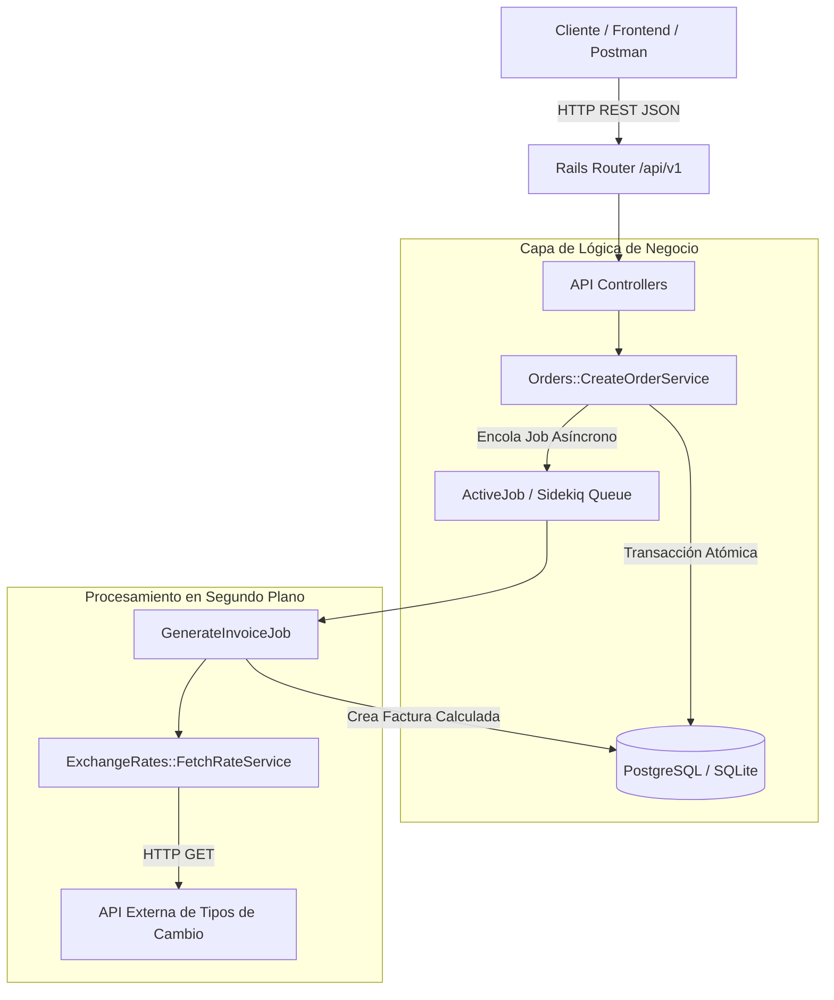
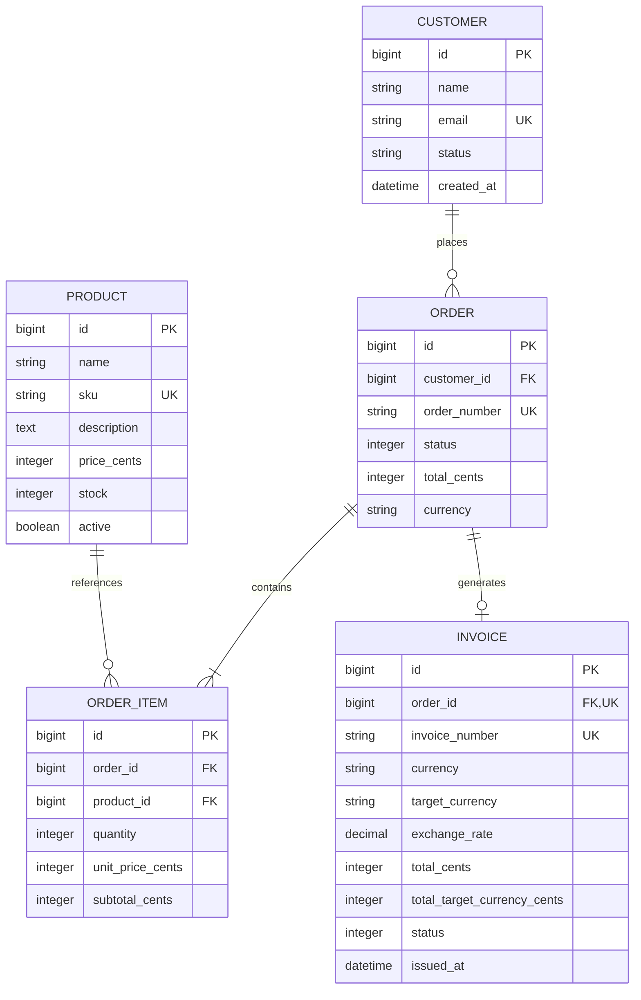

# ⚡ Smart Billing & Inventory API

> **API RESTful de alto rendimiento en Ruby on Rails** diseñada para gestión de pedidos, facturación multimoneda con conversión en tiempo real, control atómico de inventario y procesamiento asíncrono en segundo plano.


---

## 🎯 Propósito del Proyecto

Este proyecto fue desarrollado bajo estándares de arquitectura limpia (*Clean Architecture*) y principios SOLID para demostrar el dominio técnico requerido en vacantes Backend Ruby on Rails competitivas:

* **Control Atómico de Inventario:** Prevención de sobreventa (*overselling*) y condiciones de carrera (*race conditions*) utilizando transacciones de base de datos (`ActiveRecord::Base.transaction`) y bloqueo pesimista (`lock`).
* **Arquitectura Basada en Service Objects:** Desacoplamiento de la lógica de negocio de los controladores y modelos mediante el patrón `Service Object` con resultado estandarizado (`ApplicationService::Result`).
* **Procesamiento Asíncrono en Segundo Plano:** Encolado de tareas pesadas con **ActiveJob** y soporte para **Sidekiq + Redis**, evitando bloquear la respuesta HTTP al cliente.
* **Consumo Resiliente de APIs Externas:** Integración con API de tipo de cambio en vivo (*Exchange Rates API*) mediante `Faraday` con mecanismo de respaldo (*fallback cache*) ante caídas de red.
* **TDD / BDD Exhaustivo con RSpec:** Suite de 52 pruebas unitarias y de integración que cubren modelos, controladores, servicios y jobs.
* **Estándar de Calidad de Código:** Cumplimiento total de la guía de estilo oficial de Ruby verificada con **RuboCop** (0 infracciones).

---

## 🏗️ Diagrama de Arquitectura



---

## 📊 Modelo Entidad-Relación



---

## 📖 Documentación Interactiva y Colección Postman

* **Swagger UI (OpenAPI 3.0):** Disponible en vivo en [http://localhost:3000/docs](http://localhost:3000/docs) (o `/api-docs/index.html`). Permite explorar y probar todos los endpoints interactivamente desde el navegador.
* **Colección de Postman:** Se incluye el archivo listo para importar con 1 clic en la raíz del repositorio:
  📁 [`Smart_Billing_API.postman_collection.json`](file:///c:/Users/PC/Desktop/Proyecto%20backend%202/Smart_Billing_API.postman_collection.json) con todas las peticiones, variables (`{{baseUrl}}`) y ejemplos de respuestas exitosas y de error (422).

---

## 🚀 Endpoints de la API

Todos los endpoints están versionados bajo el prefijo `/api/v1` y responden con formato JSON estándar:

```json
{
  "success": true,
  "data": { ... }
}
```

### 1. Monitoreo y Salud
* **`GET /api/v1/health`**: Verifica el estado de salud del servicio, base de datos y entorno.

### 2. Productos
* **`GET /api/v1/products`**: Lista de productos.
  * *Query params:* `?active=true`, `?in_stock=true`.
* **`GET /api/v1/products/:id`**: Detalle de un producto.
* **`POST /api/v1/products`**: Creación de producto.
  ```json
  {
    "product": {
      "name": "Monitor Curvo 34'",
      "sku": "MON-34-ULTRA",
      "description": "Monitor IPS 144Hz WQHD",
      "price_cents": 49999,
      "stock": 20,
      "active": true
    }
  }
  ```

### 3. Órdenes
* **`GET /api/v1/orders`**: Lista de órdenes con prefetching de relaciones.
  * *Query params:* `?customer_id=1`, `?status=paid`.
* **`GET /api/v1/orders/:id`**: Detalle de una orden con sus productos y factura asociada.
* **`POST /api/v1/orders`**: Creación atómica de orden y disparo de facturación asíncrona.
  ```json
  {
    "order": {
      "customer_id": 1,
      "currency": "USD",
      "items": [
        { "product_id": 1, "quantity": 1 },
        { "product_id": 3, "quantity": 2 }
      ]
    }
  }
  ```
  *Respuesta (201 Created):*
  ```json
  {
    "success": true,
    "data": {
      "id": 2,
      "order_number": "ORD-20260922-8A3F1B",
      "status": "paid",
      "currency": "USD",
      "total_cents": 269898,
      "total_formatted": "$2698.98",
      "customer": {
        "id": 1,
        "name": "Carlos Mendoza",
        "email": "carlos.mendoza@techcorp.com"
      },
      "items": [
        {
          "id": 3,
          "product_id": 1,
          "product_name": "MacBook Pro 16' M3",
          "sku": "TECH-MBP-16",
          "quantity": 1,
          "unit_price_cents": 249900,
          "subtotal_cents": 249900,
          "subtotal_formatted": "$2499.00"
        }
      ]
    }
  }
  ```

### 4. Facturación
* **`GET /api/v1/invoices/:id`**: Consulta de factura con cálculo multimoneda generado en background.

---

## 💻 Guía de Inicio Rápido

### Opción A: Ejecución Nativa en Windows / Mac / Linux

1. **Clonar e instalar dependencias:**
   ```bash
   bundle install
   ```

2. **Preparar la base de datos y cargar semillas de prueba:**
   ```bash
   bundle exec rails db:prepare
   bundle exec rails db:seed
   ```

3. **Iniciar el servidor de desarrollo:**
   ```bash
   bundle exec rails server -p 3000
   ```
   *La API estará disponible en `http://localhost:3000/api/v1/health`.*

---

### Opción B: Ejecución con Docker Compose (Recomendado para Producción)

El proyecto incluye configuración completa para levantar la API, PostgreSQL, Redis y el worker de Sidekiq con un solo comando:

```bash
docker compose up --build
```

Servicios levantados:
* **Web API**: `http://localhost:3000`
* **PostgreSQL 16**: puerto `5432`
* **Redis 7**: puerto `6379`
* **Sidekiq Worker**: procesando colas en segundo plano

---

## 🧪 Pruebas Automatizadas (RSpec)

Ejecuta la suite completa de pruebas unitarias y de integración:

```bash
# Ejecutar todas las pruebas con salida detallada
bundle exec rspec --format documentation
```

**Resultado:**
```text
Customer
  validations & associations: 6 passing
Product
  validations, scopes & stock checks: 10 passing
Order
  callbacks, status enum & total calculation: 4 passing
OrderItem
  pricing callback & quantity validation: 2 passing
Invoice
  number generation, exchange rate & formatters: 3 passing
Orders::CreateOrderService
  transaction rollback, atomic stock deduction & job enqueuing: 5 passing
ExchangeRates::FetchRateService
  external API consumption & network fallback: 3 passing
GenerateInvoiceJob
  async invoice generation & idempotency: 2 passing
API Requests (Health, Products, Orders, Invoices)
  HTTP 200, 201, 400, 404, 422: 17 passing

Finished in 0.78 seconds
52 examples, 0 failures
```

---

## 🎨 Linter y Calidad de Código (RuboCop)

Verifica que el código cumpla con las convenciones oficiales de la comunidad Ruby:

```bash
bundle exec rubocop
```
*Resultado: `59 files inspected, no offenses detected`.*

---

## 🛠️ Tecnologías y Gemas Utilizadas

* **Ruby 3.3.12**
* **Ruby on Rails 8.1.3** (Modo `--api`)
* **PostgreSQL / SQLite3**
* **Sidekiq & Redis**
* **Faraday** (HTTP Client)
* **RSpec Rails 7.1**
* **FactoryBot & Faker**
* **RuboCop Rails Omakase**
* **Docker & Docker Compose**
